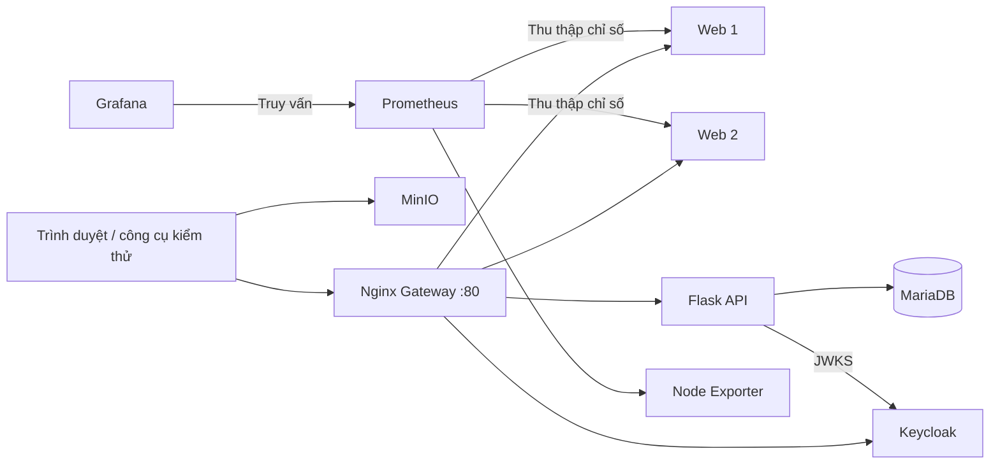

# MyMiniCloud

Đồ án cuối kỳ môn **Điện toán đám mây**, mô phỏng chín nhóm chức năng hạ tầng trong **11 container Docker**. Hệ thống tích hợp Web, REST API, cơ sở dữ liệu, xác thực, lưu trữ đối tượng, DNS, giám sát và Gateway; được triển khai trên máy cục bộ và Ubuntu thuộc AWS EC2.

| Tài nguyên | Liên kết |
| --- | --- |
| Mã nguồn chính thức | [Nhánh `main`](https://github.com/KwanFam26022005/Final-CloudComputing/tree/main) |
| Video minh chứng | [Xem video trên Google Drive](https://drive.google.com/file/d/1A99We8Nqj2SfNNMI-GB-VwsGnWnGUIFX/view) — 8 phút 12 giây, Full HD 1920×1080, 30 fps, chú thích tiếng Việt |
| Ảnh container Web | [`kwan2602/myminicloud-web:v1.0`](https://hub.docker.com/r/kwan2602/myminicloud-web/tags) |
| Ảnh container ứng dụng | [`kwan2602/myminicloud-app:v1.0`](https://hub.docker.com/r/kwan2602/myminicloud-app/tags) |
| Minh chứng trong kho mã nguồn | [Ảnh](docs/acceptance/evidence/) · [Nhật ký kiểm thử](docs/acceptance/logs/) |

Báo cáo PDF và `LIEN-KET.txt` được cung cấp trong gói nộp bài. Video tổng hợp các luồng chức năng, thao tác kiểm tra và kết quả quan sát; các mốc nội dung được liệt kê ở cuối trang.

## Kiến trúc



Tất cả dịch vụ tham gia mạng bridge `cloud-net` và sử dụng `restart: unless-stopped`. Docker DNS phân giải tên dịch vụ để giao tiếp nội bộ. BIND9 phục vụ riêng vùng `cloud.local`; các địa chỉ `10.10.10.x` trong vùng là dữ liệu bài thực hành, không phải IP thực được cấp cho container.

| Nhóm chức năng | Thành phần | Cổng máy chủ → container |
| --- | --- | --- |
| Giao diện Web | Hai bản sao Nginx, trang chủ và ba bài blog | `8080 → 80`, `8082 → 80` |
| Ứng dụng | Flask, API sinh viên và CRUD | `8085 → 8081` |
| Cơ sở dữ liệu | MariaDB 11, `minicloud` và `studentdb` | `3306 → 3306` |
| Xác thực | Keycloak, realm `realm_52300107`, client `flask-app` | `8081 → 8080` |
| Lưu trữ đối tượng | MinIO API và Console | `9000 → 9000`, `9001 → 9001` |
| DNS nội bộ | BIND9, vùng `cloud.local` | `1053 → 53`, UDP và TCP |
| Thu thập chỉ số | Prometheus và Node Exporter | `9090 → 9090`, `9100 → 9100` |
| Trực quan hóa | Grafana | `3000 → 3000` |
| Cổng truy cập | Nginx Gateway, cân bằng tải Round Robin | `80 → 80` |

## Khởi chạy trên máy cục bộ

Cần Git và Docker Compose v2. Trên Windows/macOS, Docker Desktop phải sử dụng Linux containers. Lần xây dựng đầu tiên cần Internet; MinIO được biên dịch từ mã nguồn nên có thể mất nhiều thời gian hơn các dịch vụ khác. Không cần cài Go hoặc Python trên máy chủ để khởi chạy cụm.

### 1. Lấy mã nguồn và tạo cấu hình

```bash
git clone https://github.com/KwanFam26022005/Final-CloudComputing.git
cd Final-CloudComputing
```

Tạo `.env` trên Bash:

```bash
cp .env.example .env
```

Hoặc trên PowerShell:

```powershell
Copy-Item .env.example .env
```

Các giá trị trong `.env.example` dành cho thực hành. Điều chỉnh mật khẩu và cổng theo môi trường; không đưa `.env` chứa thông tin đăng nhập thực tế vào Git. Realm thử nghiệm là `realm_52300107`; cấu hình chi tiết và tài khoản thử nghiệm được mô tả trong [tài liệu Keycloak](authentication-identity-server/README.md).

### 2. Xây dựng ảnh và khởi động dịch vụ

Các lệnh sau dùng được trong Bash và PowerShell:

```bash
docker compose config -q
docker compose build web-frontend-server application-backend-server object-storage-server
docker compose up -d --no-build
docker compose ps
```

Hai dịch vụ Web dùng chung một ảnh, vì vậy chỉ xây dựng `web-frontend-server` một lần. MinIO sử dụng Dockerfile của dự án; không cần thay bằng ảnh `minio/minio:latest`.

Sau khi container sẵn sàng, mở [Gateway](http://localhost/). Nếu dịch vụ chưa phản hồi, xem trạng thái và nhật ký:

```bash
docker compose ps
docker compose logs --tail=100 api-gateway-proxy-server authentication-identity-server
```

### 3. Chuẩn bị dữ liệu thực hành

SQL khởi tạo, realm Keycloak và cấu hình Grafana được nạp từ mã nguồn. SQL chỉ chạy khi vùng dữ liệu MariaDB được khởi tạo lần đầu; realm import không ghi đè realm đã tồn tại.

Dữ liệu MinIO không được đóng gói trong Git. Trên máy mới, thực hiện theo [hướng dẫn lưu trữ](object-storage-server/README.md) để:

1. Tạo bucket `demo`, tải lên `web-frontend-server/html/index.html`, tải xuống và đối chiếu nội dung.
2. Tạo `profile-pics`, tải ảnh JPEG `avatar.jpg` và chỉ cấp quyền đọc ẩn danh cho đối tượng cần công khai. Cấu hình minh chứng có thêm `avatar-2.jpg` và `avatar-3.jpg`.
3. Tạo `documents`, tải báo cáo PDF lên và giữ bucket riêng tư.

Chỉ kiểm tra trạng thái container `Up` chưa đủ xác nhận các dữ liệu và quyền truy cập này đã được chuẩn bị.

## Các điểm truy cập

| Chức năng | Địa chỉ cục bộ |
| --- | --- |
| Trang chủ / Blog qua Gateway | `http://localhost/` · `http://localhost/blog/` |
| API kiểm tra | `http://localhost/api/hello` |
| Năm sinh viên từ JSON | `http://localhost/api/student` · `http://localhost/student/` |
| Sinh viên từ MariaDB | `http://localhost/api/students-db` |
| API có xác thực | `http://localhost/api/secure` — cần Bearer token |
| Keycloak qua Gateway | `http://localhost/auth/` — chuyển hướng đến giao diện Keycloak |
| Hai máy chủ Web trực tiếp | `http://localhost:8080/` · `http://localhost:8082/` |
| API Flask trực tiếp | `http://localhost:8085/hello` |
| Keycloak trực tiếp | `http://localhost:8081/` |
| MinIO Console / ảnh công khai | `http://localhost:9001/` · `http://localhost:9000/profile-pics/avatar.jpg` |
| Prometheus | `http://localhost:9090/targets` |
| Grafana | `http://localhost:3000/` |

Gateway phân phối yêu cầu Web qua hai bản sao theo Round Robin. Header `X-Served-By` nhận diện máy chủ phục vụ. Các tuyến `/admin/`, `/realms/` và `/resources/` được chuyển tiếp đến Keycloak để hoàn tất luồng chuyển hướng từ `/auth/`.

## Kiểm thử

Chạy từ thư mục gốc dự án sau khi dịch vụ và dữ liệu đã sẵn sàng.

**PowerShell:**

```powershell
.\scripts\verify-base.ps1
.\scripts\verify-extended.ps1
```

**Bash trên Linux hoặc EC2:**

```bash
bash scripts/verify-base.sh
bash scripts/verify-extended.sh
```

Các tập lệnh trả mã thoát `1` nếu ghi nhận lỗi. Nếu thay mật khẩu MariaDB hoặc Grafana trong `.env`, cần đặt các biến shell tương ứng (`MARIADB_ROOT_PASSWORD`, `GF_SECURITY_ADMIN_USER`, `GF_SECURITY_ADMIN_PASSWORD`) trước khi chạy; các tập lệnh này không tự nạp `.env`.

| Nhóm kiểm thử | Kết quả của cấu hình đã nghiệm thu |
| --- | --- |
| Cơ bản | `PASS=26 FAIL=0` trên máy cục bộ và EC2 |
| Mở rộng | `PASS=17 FAIL=0` trên máy cục bộ và EC2 |
| API bảo vệ | Mỗi tuyến: hai tài khoản hợp lệ nhận 200; thiếu token, token sai định dạng và chữ ký bị sửa nhận 401 |
| Round Robin | Sáu yêu cầu liên tiếp nhận diện luân phiên hai máy chủ Web |
| Giám sát | Prometheus: `node` 1/1 UP, `web` 2/2 UP, `prometheus` 1/1 UP; Grafana có dữ liệu |

Đây là kết quả kiểm thử chức năng trong đợt nghiệm thu 10–13/11/2026, không phải chỉ số hiệu năng hoặc bảo đảm trạng thái dịch vụ tại mọi thời điểm. Bộ kiểm thử cơ bản kiểm tra cả trang đích Keycloak sau chuyển hướng, tránh bỏ sót trường hợp `/auth/` trả 3xx nhưng trang đích lỗi 404.

Kiểm thử chuyên biệt và điều kiện sử dụng được trình bày tại các README của [Flask](application-backend-server/), [Keycloak](authentication-identity-server/README.md), [MinIO](object-storage-server/README.md) và [DNS](internal-dns-server/README.md). Các thao tác tái tạo container hoặc kiểm tra quyền ghi cần được thực hiện theo đúng phạm vi của từng hướng dẫn.

## Triển khai EC2 và giới hạn

Môi trường nghiệm thu sử dụng Ubuntu 24.04 LTS, loại máy `c7i-flex.large`, RAM 4 GB, EBS gp3 mã hóa 30 GB tại `ap-southeast-1`. IP công khai khi kiểm tra là `13.229.212.14`; [trang chủ](http://13.229.212.14/) sử dụng cổng Gateway 80. Địa chỉ và khả năng truy cập có thể thay đổi theo vòng đời máy ảo.

Security Group mở công khai cổng 80; SSH và các cổng quản trị chỉ cho phép IP được chỉ định. MariaDB 3306 không được mở từ Internet. Video phân biệt các phép thử HTTP qua IP công khai với ảnh giao diện EC2 truy cập qua đường hầm SSH. Tham khảo [hướng dẫn triển khai](docs/06-AWS-EC2-DEPLOYMENT.md) và [hồ sơ truy cập EC2](docs/acceptance/EC2-ACCESS.md).

Mô hình phục vụ học tập và còn các giới hạn:

- Flask hiện tắt kiểm tra issuer/audience của JWT; Keycloak dùng `start-dev` và hệ thống chưa có HTTPS.
- Toàn bộ container chạy trên một máy EC2; chưa có dự phòng đa máy, tự động mở rộng hoặc kết quả thử tải.
- Node Exporter chưa được cấu hình để quan sát đầy đủ máy chủ và từng container. Chỉ số Web hiện phản ánh khả năng phản hồi, chưa đo số yêu cầu hoặc độ trễ.
- Chưa kiểm chứng đầy đủ token hết hạn, URL ký hết hạn, tài khoản MinIO chỉ đọc, lưu lịch sử Prometheus qua tái tạo container và phục hồi toàn cụm sau khi EC2 khởi động lại.

## Tài liệu và thành viên

| Tài liệu | Nội dung |
| --- | --- |
| [Yêu cầu](docs/01-BUSINESS-AND-REQUIREMENTS.md) | Các chức năng cơ bản và mở rộng |
| [Kiến trúc và mạng](docs/02-ARCHITECTURE-AND-NETWORK.md) | Vai trò dịch vụ, cổng và tên miền |
| [Quy ước làm việc](docs/03-RULES-AND-CONVENTIONS.md) | Git, tổ chức mã nguồn và cấu hình |
| [Phân công](docs/04-TEAM-WORK-DIVISION.md) | Phạm vi thực hiện của từng thành viên |
| [Hướng dẫn kiểm thử](docs/05-TESTING-AND-DEMO-GUIDE.md) | Các bước kiểm tra chức năng |
| [Triển khai AWS](docs/06-AWS-EC2-DEPLOYMENT.md) | Docker Hub và EC2 |
| [Đề cương báo cáo](docs/07-REPORT-OUTLINE.md) | Bố cục năm chương và phụ lục |

| Thành viên | MSSV | Nội dung phụ trách |
| --- | --- | --- |
| Lê Văn Duy | 52300102 | Web, Gateway và cân bằng tải |
| Phạm Hồng Đăng Khoa | 52300119 | Flask, MariaDB và CRUD |
| Nguyễn Mạnh Hùng | 52300107 | Keycloak, MinIO và DNS |
| Phan Minh Nhật | 52300140 | Prometheus, Grafana và EC2 |

## Mục lục video

| Thời điểm | Nội dung |
| --- | --- |
| 00:00 | Giới thiệu |
| 00:10 | Hạ tầng và container |
| 00:46 | Web và blog |
| 01:46 | API và dữ liệu |
| 02:40 | Xác thực |
| 03:40 | Lưu trữ |
| 04:40 | DNS |
| 04:58 | Giám sát |
| 05:52 | Gateway và cân bằng tải |
| 06:22 | Triển khai EC2 |
| 07:26 | Công bố ảnh container |
| 07:42 | Tổng hợp kết quả |
