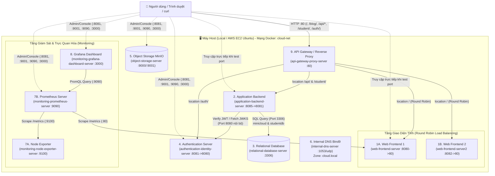
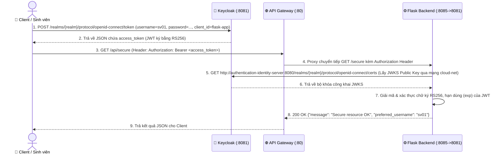

# 02. Kiến Trúc Hệ Thống, Quy Hoạch Mạng & Xử Lý 6 Bẫy Kỹ Thuật

Tài liệu này mô tả chi tiết kiến trúc kỹ thuật của **MyMiniCloud**, luồng dữ liệu giữa các container trên mạng `cloud-net`, quy hoạch cổng/tên miền, và giải pháp kỹ thuật đã được tích hợp vào Foundation để tránh mất điểm oan.

---

## 1. Sơ Đồ Kiến Trúc Tổng Thể (System Architecture)

---

## 2. Luồng Đi Của Request (Request Flows)

### 2.1. Luồng truy cập Web & Cân bằng tải (Load Balancing Flow)
1. Client gửi HTTP request tới `http://localhost/` hoặc `http://localhost/blog/`.
2. `api-gateway-proxy-server` (Nginx cổng 80) nhận request tại block `location /`.
3. Proxy chuyển tiếp (`proxy_pass`) tới cụm `upstream web_backend` gồm `web-frontend-server:80` và `web-frontend-server2:80` theo thuật toán **Round Robin** (luân phiên 1:1).
4. Mỗi Web Server trả về trang HTML tĩnh kèm HTTP Response Header `X-Served-By: web-frontend-server1` (hoặc `web-frontend-server2`) để dễ dàng kiểm chứng cân bằng tải.

### 2.2. Luồng gọi API & Kết nối Database (API & RDBMS Flow)
1. Client gọi `http://localhost/api/hello`, `http://localhost/api/student`, `http://localhost/student/`, hoặc `http://localhost/api/students-db`.
2. `api-gateway-proxy-server` strip tiền tố `/api/` (hoặc map `/student/`) và chuyển tiếp tới `http://application-backend-server:8081/...`.
3. Tại `application-backend-server` (Flask):
   - Với `/hello`: Trả ngay JSON `{"message": "Hello from App Server!"}`.
   - Với `/student`: Đọc dữ liệu từ file tĩnh `students.json` và trả về danh sách 5 sinh viên.
   - Với `/students-db`: Mở kết nối TCP tới `relational-database-server:3306`, truy vấn `SELECT * FROM studentdb.students` và trả về danh sách JSON.

### 2.3. Luồng Xác Thực OIDC (Keycloak Authentication Flow)

---

## 3. Bảng Quy Hoạch Cổng (Ports), Tên Container & Network Aliases

Đây là bảng chuẩn hóa **TUYỆT ĐỐI KHÔNG ĐƯỢC TỰ Ý THAY ĐỔI** để đảm bảo toàn bộ script chấm bài và lệnh kiểm thử trong đề đều hoạt động:

| STT | Container Name chuẩn | Host Port | Container Port | Network Aliases trong `cloud-net` | Tên miền nội bộ (`cloud.local`) | IP Tĩnh DNS (`db.cloud.local`) |
| :-: | :--- | :---: | :---: | :--- | :--- | :---: |
| 1A | `web-frontend-server` | `8080` | `80` | `web`, `web-server`, `web-frontend-server1` | `web-frontend-server.cloud.local` | `10.10.10.10` |
| 1B | `web-frontend-server2` | `8082` | `80` | `web2`, `web-frontend-server2` | `web2.cloud.local` | `10.10.10.11` |
| 2 | `application-backend-server` | `8085` | `8081` | `app`, `app-server`, `app-backend` | `app-backend.cloud.local` | `10.10.10.20` |
| 3 | `relational-database-server` | `3306` | `3306` | `db`, `mysql`, `mariadb` | `db.cloud.local` | `10.10.10.25` |
| 4 | `authentication-identity-server` | `8081` | `8080` | `keycloak`, `auth` | `keycloak.cloud.local` | `10.10.10.40` |
| 5 | `object-storage-server` | `9000`, `9001` | `9000`, `9001` | `minio`, `storage` | `minio.cloud.local` | `10.10.10.30` |
| 6 | `internal-dns-server` | `1053/udp` | `53/udp` | `dns`, `dns-server` | `ns.cloud.local` | `127.0.0.1` |
| 7A | `monitoring-node-exporter-server` | `9100` | `9100` | `node-exporter` | `node-exporter.cloud.local` | `10.10.10.50` |
| 7B | `monitoring-prometheus-server` | `9090` | `9090` | `prometheus`, `monitor` | `prometheus.cloud.local` | `10.10.10.51` |
| 8 | `monitoring-grafana-dashboard-server` | `3000` | `3000` | `grafana` | `grafana.cloud.local` | `10.10.10.52` |
| 9 | `api-gateway-proxy-server` | `80` | `80` | `proxy`, `gateway` | `gateway.cloud.local` | `10.10.10.1` |

---

## 4. Phân Tích 6 "Bẫy Kỹ Thuật" Trong Đề Bài & Cách Foundation Đã Giải Quyết

Khi làm theo hướng dẫn mẫu trong file Word của giảng viên, sinh viên thường gặp **6 lỗi kỹ thuật** dẫn đến bị trừ điểm. Hệ thống Foundation này đã thiết kế sẵn cơ chế phòng vệ:

### 🛠️ Bẫy 1: Target `web-frontend-server:80` trong Prometheus bị báo đỏ (`DOWN`)
- **Hiện tượng:** Yêu cầu mở rộng #7 bảo thêm `targets: ['web-frontend-server:80']` vào `prometheus.yml`. Khi Prometheus scrape, nó mặc định gọi `GET http://web-frontend-server:80/metrics`. Vì Nginx mặc định không có file `/metrics`, nó trả về `404 Not Found` (hoặc trang HTML), làm Prometheus báo lỗi `server returned HTTP status 404 Not Found` và trạng thái **`DOWN`**.
- **Giải pháp trong Foundation:** Trong `web-frontend-server/conf.default`, chúng ta cấu hình sẵn `location = /metrics` trả về `200 OK` với `Content-Type: text/plain; version=0.0.4` chứa metric chuẩn Prometheus. Kết quả: Target `web` trên Prometheus luôn báo **`UP (1/1)`** xanh lá!

### 🛠️ Bẫy 2: Không thống nhất tên gọi Container trong các lệnh kiểm thử của đề
- **Hiện tượng:** Trong `docker-compose.yml` đặt tên dài (`relational-database-server`, `monitoring-prometheus-server`...), nhưng lệnh kiểm thử trong đề lại gõ:
  - `mysql -h db -uroot -proot ...`
  - `http://prometheus:9090` (trong Grafana Datasource)
  - `ping -c 3 web`, `ping -c 3 app-server`, `ping -c 3 db`, `ping -c 3 keycloak`, `ping -c 3 minio`, `ping -c 3 dns-server`
- **Giải pháp trong Foundation:** Cấu hình `networks.cloud-net.aliases` trong `docker-compose.yml` cho mọi service. Nhờ đó, Docker DNS nội bộ phân giải được **cả tên dài lẫn tên ngắn**.

### 🛠️ Bẫy 3: Lỗi `Invalid issuer` hoặc `Invalid audience` khi gọi `/secure` với Keycloak Token
- **Hiện tượng:**
  1. Khi user lấy token qua `http://localhost:8081/realms/realm_sv001/...`, trường `iss` trong JWT là `http://localhost:8081/realms/realm_sv001`, nhưng `app.py` trong container lại kiểm tra `ISSUER = "http://authentication-identity-server:8080/realms/master"`.
  2. Public client `flask-app` trong Keycloak mới tạo mặc định có `aud = "account"` (hoặc không có `myapp`), dẫn tới `jwt.decode` báo lỗi `Invalid audience`.
- **Giải pháp trong Foundation:** Trong `application-backend-server/app.py`, hàm xác thực JWT tự động trích xuất tên `realm` từ payload của token để gọi đúng `http://authentication-identity-server:8080/realms/<realm>/protocol/openid-connect/certs` trong mạng nội bộ, đồng thời chấp nhận linh hoạt `issuer`/`audience` từ cả `master` và `realm_<mssv>`.

### 🛠️ Bẫy 4: Mất sạch cấu hình Keycloak & Grafana khi chạy trên máy khác hoặc AWS EC2
- **Hiện tượng:** Cấu hình tạo bằng tay trên giao diện web của Keycloak và Grafana sẽ biến mất khi xóa container hoặc khi kéo code lên AWS EC2.
- **Giải pháp trong Foundation:**
  - `authentication-identity-server` bật cờ `--import-realm` và gắn volume `./authentication-identity-server/import:/opt/keycloak/data/import:ro`.
  - `monitoring-grafana-dashboard-server` gắn volume `./monitoring-grafana-dashboard-server/provisioning:/etc/grafana/provisioning:ro` để tự động nạp Datasource Prometheus và Dashboard.

### 🛠️ Bẫy 5: Thiếu `restart: unless-stopped`
- **Hiện tượng:** Yêu cầu kỹ thuật chung bắt buộc mọi service có `restart: unless-stopped`, nhưng code mẫu của đề chỉ có ở 2 service.
- **Giải pháp trong Foundation:** Toàn bộ 100% services trong `docker-compose.yml` đều đã được khai báo `restart: unless-stopped`.

### 🛠️ Bẫy 6: Minh chứng Load Balancing Round Robin không rõ ràng
- **Hiện tượng:** Nếu 2 container `web-frontend-server1` và `web-frontend-server2` có nội dung y hệt 100%, khi `curl http://localhost/` liên tiếp sẽ không nhìn thấy sự luân phiên giữa 2 server.
- **Giải pháp trong Foundation:** Dockerfile của `web-frontend-server` nhận biến `ARG SERVER_NODE_NAME` để nhúng tên Node (`web-frontend-server1` vs `web-frontend-server2`) vào cả nội dung HTML lẫn HTTP Header `X-Served-By`. Khi chạy `curl http://localhost/`, kết quả luân phiên thể hiện rõ ràng ngay lập tức.
