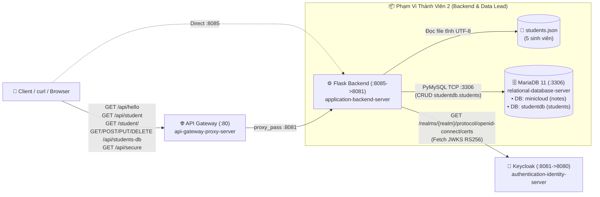

# Thiết Kế Chi Tiết Task 2: Application Backend & Relational Database (Backend & Data Lead)

**Ngày:** 2026-10-26  
**Thành viên phụ trách:** Thành viên 2 – Backend & Data Lead  
**Nhánh Git:** `feat/m2-backend-data-lead` *(Tuyệt đối không push trực tiếp lên `main`)*  
**Phạm vi thư mục:** `application-backend-server/`, `relational-database-server/`, `scripts/verify-task2.*`, `docs/member2-backend-db-report.md`  
**Phương án chọn:** Phương án 1 – Chuẩn Đề Bài + Bổ sung CRUD Tự Động & Tài Liệu Báo Cáo Chuyên Sâu

---

## 1. Mục Tiêu & Phạm Vi Đạt Điểm (2.0 / 10.0 Điểm Trực Tiếp)

1. **Cơ bản #2 (`0.5 điểm`) – Application Backend Server (`application-backend-server`):**
   - Cung cấp REST API `GET /hello` trả về `{"message": "Hello from App Server!"}` (trực tiếp qua cổng `8085` và qua API Gateway `/api/hello`).
   - Cung cấp REST API `GET /secure` xác thực JWT Bearer Token chuẩn OIDC từ Keycloak (`authentication-identity-server:8080`), hỗ trợ tự động trích xuất Realm (`master` hoặc `realm_<mssv>`) và cache JWKS.
2. **Cơ bản #3 (`0.5 điểm`) – Relational Database Server (`relational-database-server`):**
   - Tự động khởi tạo CSDL `minicloud`, bảng `notes` và bản ghi `'Hello from MariaDB!'` ngay khi container MariaDB khởi chạy lần đầu.
3. **Mở rộng #2 (`0.5 điểm`) – Backend API `/student` đọc từ `students.json`:**
   - Hoàn thiện file `application-backend-server/students.json` chứa danh sách **5 sinh viên** với đầy đủ 4 trường: `id`, `name`, `major`, `gpa`.
   - Cung cấp endpoint `GET /student` trả về mảng JSON 5 sinh viên, truy cập thông suốt qua `:8085/student`, `/api/student` và `/student/`.
4. **Mở rộng #3 (`0.5 điểm`) – CSDL `studentdb`, Bảng `students`, Thực hành CRUD & API `/students-db`:**
   - Tự động khởi tạo CSDL `studentdb` và bảng `students` (`id`, `student_id`, `fullname`, `dob`, `major`) với tối thiểu 4 bản ghi khởi tạo.
   - Cung cấp kịch bản SQL thực hành CRUD tự động (`relational-database-server/crud_practice.sql`) minh chứng đầy đủ `SELECT`, `INSERT`, `UPDATE`, `DELETE`.
   - Cung cấp bộ REST API kết nối trực tiếp MariaDB:
     - `GET /students-db`: Đọc danh sách sinh viên từ `studentdb.students`.
     - `POST /students-db`: Thêm mới sinh viên vào `studentdb.students`.
     - `PUT /students-db/<student_id>`: Cập nhật thông tin sinh viên theo `student_id`.
     - `DELETE /students-db/<student_id>`: Xóa sinh viên theo `student_id`.
5. **Hạ tầng Docker Hub & Báo cáo Chương 3, 4:**
   - Đóng gói script kiểm thử tự động riêng cho Task 2 (`scripts/verify-task2.ps1` và `scripts/verify-task2.sh`).
   - Biên soạn tài liệu báo cáo hoàn chỉnh của Thành viên 2 tại `docs/member2-backend-db-report.md` (Chương 3 mục 3.4, 3.5; Chương 4 mục 4.1.3, 4.1.4, 4.2.2, 4.2.3; hướng dẫn push image `<dockerhub_user>/myminicloud-app:latest`).

---

## 2. Kiến Trúc & Luồng Dữ Liệu Của Task 2



---

## 3. Thiết Kế Chi Tiết Từng Thành Phần

### 3.1. `application-backend-server/`

#### Cấu trúc file:
- `Dockerfile`: Base `python:3.11-alpine`, cài đặt `requirements.txt`, copy `app.py` và `students.json`, expose port `8081`.
- `requirements.txt`: `flask==3.0.0`, `requests==2.31.0`, `python-jose[cryptography]==3.3.0`, `pymysql==1.1.1`.
- `students.json`: Mảng 5 đối tượng sinh viên, mỗi đối tượng gồm `id` (`str`), `name` (`str`), `major` (`str`), `gpa` (`float`).
- `app.py`:
  - Hàm kết nối DB dùng chung `get_db_connection()` trả về `pymysql.connections.Connection` với `DictCursor` và `connect_timeout=5`.
  - Hàm `validate_student_payload(payload: dict, partial: bool = False) -> tuple[bool, str]` kiểm tra tính hợp lệ của dữ liệu đầu vào (`student_id`, `fullname`, `dob` định dạng `YYYY-MM-DD`, `major`).
  - Các endpoints:
    1. `GET /health`: Trả về `{"status": "ok", "service": "application-backend-server"}`, HTTP `200`.
    2. `GET /hello`: Trả về `{"message": "Hello from App Server!"}`, HTTP `200`.
    3. `GET /secure`: Kiểm tra header `Authorization: Bearer <token>`, xác thực chữ ký RS256 qua JWKS của Keycloak, trả về `{"message": "Secure resource OK", "preferred_username": ..., "realm": ..., "client_id": ...}` (HTTP `200`) hoặc `{"error": ...}` (HTTP `401`).
    4. `GET /student`: Đọc `students.json` (tính theo đường dẫn tuyệt đối của thư mục chứa `app.py` để không phụ thuộc working directory), trả về danh sách JSON (HTTP `200`).
    5. `GET /students-db`: Truy vấn `SELECT id, student_id, fullname, CAST(dob AS CHAR) AS dob, major FROM students ORDER BY id ASC;`, trả về `{"source": "MariaDB (studentdb.students)", "count": len(rows), "students": rows}` (HTTP `200`).
    6. `POST /students-db`: Nhận JSON `{"student_id", "fullname", "dob", "major"}`, thực thi `INSERT INTO students ...`, trả về bản ghi vừa tạo kèm HTTP `201` (hoặc `400` nếu thiếu/sai định dạng trường, `409` nếu trùng `student_id`).
    7. `PUT /students-db/<student_id>`: Nhận JSON chứa các trường cần sửa (`fullname`, `dob`, `major`), thực thi `UPDATE students SET ... WHERE student_id = %s`, trả về bản ghi sau cập nhật kèm HTTP `200` (hoặc `404` nếu không tồn tại `student_id`).
    8. `DELETE /students-db/<student_id>`: Thực thi `DELETE FROM students WHERE student_id = %s`, trả về `{"message": "Student deleted successfully", "student_id": student_id}` kèm HTTP `200` (hoặc `404` nếu không tồn tại).
- `tests/test_app.py`: Bộ unit test (`unittest` chuẩn của Python để chạy được ngay trên mọi môi trường mà không cần cài thêm package ngoài) kiểm tra toàn bộ endpoints và các trường hợp lỗi (400, 401, 404, 409, 500).

### 3.2. `relational-database-server/`

#### Cấu trúc file:
- `init/001_init.sql`:
  - Tạo database `minicloud`, bảng `notes`, chèn `'Hello from MariaDB!'`.
- `init/002_studentdb.sql`:
  - Tạo database `studentdb` (`CHARACTER SET utf8mb4 COLLATE utf8mb4_unicode_ci`).
  - Tạo bảng `students`:
    - `id INT PRIMARY KEY AUTO_INCREMENT`
    - `student_id VARCHAR(10) NOT NULL UNIQUE`
    - `fullname VARCHAR(100) NOT NULL`
    - `dob DATE NOT NULL`
    - `major VARCHAR(50) NOT NULL`
  - Chèn 4 bản ghi khởi tạo (`SV001` đến `SV004`).
- `crud_practice.sql`:
  - Kịch bản SQL tự động thực hiện tuần tự 4 bước CRUD trên bảng `studentdb.students`:
    1. **READ (Ban đầu):** `SELECT * FROM students ORDER BY id;`
    2. **CREATE (`INSERT`):** Thêm sinh viên `SV005` (`Hoang Minh E`, `2005-03-19`, `Information Systems`) và `SELECT` kiểm tra.
    3. **UPDATE (`UPDATE`):** Cập nhật `major = 'Cloud Native & DevOps'` cho `SV005` và `SELECT` kiểm tra.
    4. **DELETE (`DELETE`):** Xóa `SV005` và `SELECT` kiểm tra trạng thái cuối.

### 3.3. Công Cụ Kiểm Thử & Báo Cáo (`scripts/` & `docs/`)
- `scripts/verify-task2.ps1` & `scripts/verify-task2.sh`:
  - Chạy unit tests trong `application-backend-server/tests/test_app.py`.
  - Nếu cụm Docker đang chạy: kiểm thử tự động Cơ bản #2, Cơ bản #3, Mở rộng #2, Mở rộng #3 (bao gồm chạy `crud_practice.sql` và gọi API CRUD).
- `docs/member2-backend-db-report.md`:
  - Nội dung báo cáo hoàn chỉnh cho Thành viên 2 (Chương 3 & Chương 4) kèm hướng dẫn lệnh chụp ảnh minh chứng và push Docker Hub.

---

## 4. Quy Trình Quản Lý Nhánh Git (`feat/m2-backend-data-lead`)

1. Mọi thay đổi được commit theo chuẩn Conventional Commits (`docs(...)`, `feat(app): ...`, `feat(db): ...`, `test(app): ...`) trên nhánh **`feat/m2-backend-data-lead`**.
2. Push nhánh lên GitHub:
   ```bash
   git push -u origin feat/m2-backend-data-lead
   ```
3. **Không** merge hoặc push trực tiếp vào `main`. Khi cần ghép code với nhóm sẽ tạo Pull Request từ `feat/m2-backend-data-lead` vào `main`.
